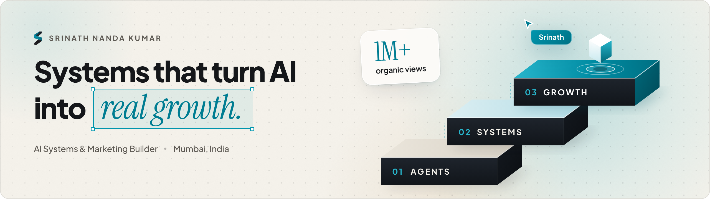

  <picture>
    <source media="(prefers-color-scheme: dark)" srcset="./assets/hero-dark.png">
    <source media="(prefers-color-scheme: light)" srcset="./assets/hero-light.png">
    
  </picture>

  <a href="https://shk2005.github.io/srinath-portfolio/">Portfolio</a>
  &nbsp;&middot;&nbsp;
  <a href="https://www.linkedin.com/in/srinath-nanda-kumar-3045a228a/">LinkedIn</a>
  &nbsp;&middot;&nbsp;
  <a href="https://www.agensi.io/creators/srinath-nanda-kumar">Agensi skills</a>
  &nbsp;&middot;&nbsp;
  <a href="mailto:srinathnandakumar91@gmail.com">Email</a>

I build AI agent workflows, code-rendered video tools, and AI search systems from Mumbai. Most of what I publish here turns fragile creative and marketing handoffs into repeatable code that runs locally.

## Featured work

| Repository | What it does | Stack |
|---|---|---|
| [motion-preflight-qa](https://github.com/Shk2005/motion-preflight-qa) | Runs an 8-gate FFmpeg check, builds 6-frame Reels, TikTok, and Shorts safe-zone contact sheets, and masters audio to `-14.0 LUFS` so code-rendered videos stop playing as black screens on iPhones. | Python, FFmpeg |
| [motion-graphics](https://github.com/Shk2005/motion-graphics) | Shareable agent skills (`motion-graphics` and `saas-animation`) for coding kinetic text ads, product explainers, and 4K SaaS animations with HyperFrames and Blender. | Python, JavaScript, HTML |
| [srinath-portfolio](https://github.com/Shk2005/srinath-portfolio) | Interactive 218-frame scroll portfolio covering AI-native brand films (`1.07M+` organic views on short-form series, `450K+` on brand film) and agentic marketing pipelines. | TypeScript, HTML |

<table>
<tr>
<td valign="top" width="50%">

### What I am building now

- Local agent skills that render and QA 60fps UI motion explainers end to end.
- Deterministic guardrails and structured evaluation scripts for local LLM workflows.
- AI search visibility and attribution pipelines for lean startup and agency teams.

</td>
<td valign="top" width="50%">

### Recently updated

<!-- recent-activity:start -->
- [srinath-portfolio](https://github.com/Shk2005/srinath-portfolio) (2026-11-25): Add v2.0 studio cover and portfolio README
- [motion-graphics](https://github.com/Shk2005/motion-graphics) (2026-11-25): Add v2.0 studio cover and polish README
- [motion-preflight-qa](https://github.com/Shk2005/motion-preflight-qa) (2026-11-25): Update v2.0 studio cover and refine README
<!-- recent-activity:end -->

</td>
</tr>
</table>

## Four-layer stack

| Layer | Focus | Tools |
|---|---|---|
| 01 | AI infrastructure | Local LLMs, Python, FFmpeg, Playwright |
| 02 | Agent systems and tooling | Claude Code, Codex, MCP, n8n, shareable `SKILL.md` suites |
| 03 | Creative and search distribution | HyperFrames, 60fps HTML/CSS motion rendering, AI search (GEO) |
| 04 | Commercial growth | Retention-first video systems, attribution, conversion pipelines |

  Open to collaborations on AI agent workflows, code-rendered video tooling, and search-driven growth systems. Reach out via <a href="mailto:srinathnandakumar91@gmail.com">email</a> or <a href="https://www.linkedin.com/in/srinath-nanda-kumar-3045a228a/">LinkedIn</a>.

